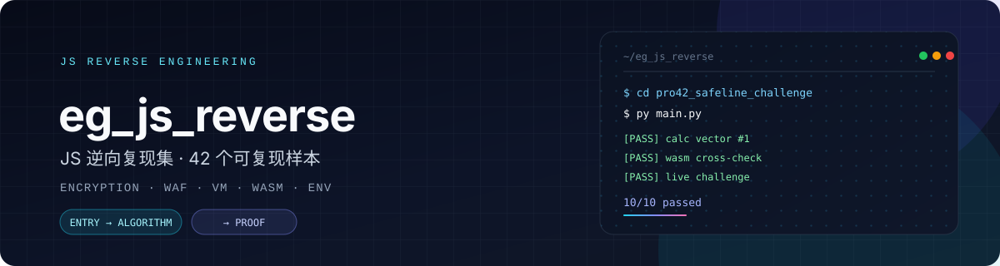

<div align="center">
  
  <h1>JS 逆向复现集</h1>
  <p><strong>把 JS 逆向拆成可复现的最小链路</strong></p>
  <p>加密入口 → 算法还原 → 离线验证 · 42 个可运行复现 + 2 个思路档案</p>
  <p>
    
    
    
    
    
  </p>
  <p>
    <a href="#快速开始">快速开始</a> ·
    <a href="#精选项目">精选项目</a> ·
    <a href="#完整索引">完整索引</a> ·
    <a href="#方法与规范">方法与规范</a> ·
    <a href="#合规与边界">合规边界</a>
  </p>
</div>

> [!IMPORTANT]
> **合规声明（必读）**：本仓库仅用于**个人学习、学术研究与授权安全测试**。所涉网站、SDK、数据的版权归其原始权利人所有；样例均为已过期、脱敏或固定随机源的测试向量。请遵守目标站点服务条款与适用法律，禁止商业爬取或任何恶意用途。详见 [LICENSE](LICENSE)。

---

## 为什么值得看

> 不是又一个爬虫仓库：每个目录都回答同一组问题——**入口在哪、算法是什么、如何证明它对**。

| | |
|---|---|
| 🧩 **最小复现** | 一个站点只保留一条核心链路；`main.py` 单文件、标准库优先、默认离线 |
| 🧪 **离线自证** | 42 个可运行项目内置 ≥3 组样例，`py main.py` 输出 PASS/FAIL，失败即 `exit(1)` |
| 🧠 **算法拆解** | 不止给结果：记录入口定位、还原步骤、JS→Python 差异与失效边界 |
| 📄 **文档型思路** | 对高对抗/敏感项目只写产品指纹、信任边界与防御启示，不提供可执行复现 |
| 🛡️ **合规边界** | 不收录工程化爬虫、代理池、验证码打码；敏感配置与凭据不进入仓库 |

## 快速开始

```bash
git clone https://github.com/jimmy-Smile-ltl/eg_js_reverse.git
cd eg_js_reverse
cd pro42_safeline_challenge && py main.py --wasm     # Windows
# Linux/macOS: python3 main.py --wasm
```

- **零网络**：可运行项目的默认样例全部离线执行，输出即验证结果
- **依赖克制**：Python 标准库优先，第三方 ≤ 2 个（见项目 README）
- **可选备份路线**：`--node` / `--wasm` / `--live`，不进入默认主流程
- **环境**：Python 3.10+；Windows 用 `py`，其他平台用 `python3`
- **📄 文档型项目**（pro43 / pro44）没有 `main.py`，直接阅读 README 与 ANALYSIS

## 精选项目

| 项目 | 为什么值得读 | 证据 |
|------|-------------|------|
| [pro42 · 长亭雷池 SafeLine](pro42_safeline_challenge/) | 468 协议 + 911B `calc.wasm`，纯 Python 还原并走通真实挑战 | ✅ 9/9；wasm 10/10；线上 200 |
| [pro37 · 小红书 mns x3](pro37_xhs_mns_x3/) | 288KB JSVMP + 自定义 XTEA + F6 静态置换 | ✅ 4/4；VM 10/10 |
| [pro36 · 抖音 a_bogus](pro36_douyin_abogus/) | SDK 字节码 VM + SM3 国密 + RC4 变体 + 双字母表 | ✅ 3/3；对拍 16/16 |
| [pro28 · 今日头条 a_bogus](pro28_toutiao_abogus/) | bdms VM 还原为 148 字符纯算法，旧版 Node 留作备份 | ✅ 7/7；Node 10/10 |
| [pro18 · 拼多多 anti_content](pro18_pinduoduo_anticontent/) | 22 collector 序列化 + zlib level 6 + budget 扰码 base64 | ✅ 20/20；Node 23/23 |
| [pro05 · 雪球 md5__1038](pro05_xueqiu_md5_1038/) | 随机 XOR + 自定义 LZW，Python/Node 固定随机源逐字节对拍 | ✅ 13/13 |
| [pro23 · 拉钩 X-S-HEADER](pro23_lagou_crypto/) | 签名 + token + 请求加密 + 响应解密 + RSA 结构，一条完整链 | ✅ 21/21 |
| [pro33 · BOSS直聘 __zp_stoken__](pro33_boss_zhipin_jsvmp/) | 双层 JSVMP + 186 项环境指纹 + UTF-8 变体编码 | ✅ 3/3；线上 5/5 |

## 完整索引

> 44 个项目按技术类型分组：42 个可运行复现 + 2 个 📄 思路档案。点击分组展开；每个目录内都有独立 README。

### 项目全景

| 分类 | 数量 | 关键词 |
|------|:---:|--------|
| 参数加密 | 20 | Crypto · 签名 · 请求/响应 |
| 混淆还原 / 反调试 | 3 | AST · jsjiami · eval |
| WAF 逆向 | 8 | 468/521 · Cookie · Turnstile · 文档型 |
| WASM / VM 保护 | 9 | JSVMP · h5st · XTEA |
| 环境指纹 / 补环境 | 1 | ConstID |
| 字体反爬 | 1 | WOFF · PUA |
| 内容加密 | 2 | JS 包装 · 正文解密 |

> 合计 **44 个目录**：**42 个可运行复现**（✅/⚠️/🔒）+ **2 个 📄 文档型思路档案**（pro43 / pro44）。

<details open>
<summary><strong>参数加密</strong> · 20 个项目</summary>

| 项目 | 技术看点 | 验证 |
|------|---------|------|
| [pro04 · 社会组织平台滑块](pro04_shzz_slide_abc/) | RSA-1024 + 双重 base64 + 滑块缺口识别 | ✅ 10/10 |
| [pro05 · 雪球 md5__1038](pro05_xueqiu_md5_1038/) | SHA1 截取 + 随机 XOR + 环境 bit + 自定义 LZW | ✅ 13/13 |
| [pro06 · 一嗨租车](pro06_1hai_aes/) | AES-256-CFB + PKCS7 + 自定义 Base64 | ✅ 8/8 |
| [pro07 · 空气质量平台](pro07_aqistudy_encrypt/) | MD5 签名 + Base64→AES-CBC→DES-CBC 解密链 | ✅ 10/10 |
| [pro08 · 网易云音乐 weapi](pro08_wangyiyun_weapi/) | 双层 AES-128-CBC + RSA-1024 零填充小端 | ✅ 7/7 |
| [pro09 · 内蒙古农机补贴](pro09_nmg_nongji_sm/) | SM4-ECB + SM3 签名 + RSA-512 引导 SM4 key | ✅ 8/8 |
| [pro10 · 颍东先锋网](pro10_yingdong_ws_aes/) | AES-128-CBC 会话密钥派生 + WebSocket 指令帧 | ✅ 8/8 |
| [pro12 · 酷狗音乐](pro12_kugou_login_crypto/) | MD5 salt + RSA-1024 NoPadding + 定制 CryptoJS AES | ✅ 8/8 |
| [pro18 · 拼多多 anti_content](pro18_pinduoduo_anticontent/) | 22 collector 序列化 + zlib + budget 扰码 base64 | ✅ 20/20 |
| [pro20 · 全球商标数据库](pro20_wipo_aes416/) | CryptoJS AES 完整还原 + 解密/重加密 + PKCE | ✅ 11/11 |
| [pro21 · 观鸟记录中心](pro21_birdreport_sign/) | 签名链 + AES 解密 + RSA 结构 + 详情 URL 派生 | ✅ 13/13 |
| [pro22 · 百度指数](pro22_baidu_index/) | 单表替换密码（真实三元组对照） | ✅ 7/7 |
| [pro23 · 拉钩 X-S-HEADER](pro23_lagou_crypto/) | 签名 + token + 请求加密/响应解密 + RSA 结构 | ✅ 21/21 |
| [pro26 · 南航 encryptArgs](pro26_nanhang/) | RSA+RC4 未逆向 + requestId 参数模板还原 | 🔒 3/3 |
| [pro27 · 财联社 sign](pro27_cls_sign/) | 参数大写排序 + 递归序列化 + SHA1→MD5 | ✅ 5/5 |
| [pro28 · 今日头条 a_bogus](pro28_toutiao_abogus/) | bdms VM → 148 字符纯算法 + Node 备份 | ✅ 7/7 |
| [pro38 · 去哪儿 Bella](pro38_qunar_bella/) | HmacSHA1 双层链 + 65 字符自定义 base64 | ✅ 3/3 |
| [pro39 · 小猪 gatesign](pro39_xiaozhu_gatesign/) | 参数排序 + 可读化替换 + HMAC-SHA1(md5(url)) | ✅ 6/6 |
| [pro40 · 途家 Revelio](pro40_tujia_revelio/) | 字符串表轮转还原 AES-GCM 密钥 + 指纹时间平移 | ✅ 4/4 |
| [pro41 · 飞猪 MTOP](pro41_fliggy_mtop/) | md5(token&t&appKey&data) + token 握手 | ✅ 4/4 |

</details>

<details>
<summary><strong>混淆还原 / 反调试</strong> · 3 个项目</summary>

| 项目 | 技术看点 | 验证 |
|------|---------|------|
| [pro13 · 樱花动漫 jsjiami](pro13_yinghua_jsjiami/) | 自定义 base64 + RC4 字符串表 + 5 层反调试 | ✅ 29/29 |
| [pro17 · 爱企查 ABCLite](pro17_aiqicha_abclite/) | `\xHH` 双重转义 + eval 劫持栈分析 + 7 类指纹 | ✅ 42/42 |
| [pro29 · 公安部编码链](pro29_mps_ast_encode/) | encode64/t/u/a 复现 + Babel AST 教学 demo | ✅ 5/5 |

</details>

<details>
<summary><strong>WAF 逆向</strong> · 8 个项目</summary>

| 项目 | 技术看点 | 验证 |
|------|---------|------|
| [pro01 · 加速乐 521](pro01_jiasule_521/) | `go()` 数据暴力双循环 + 标准 hash 掉包 | ✅ 3/3 |
| [pro02 · 云锁 WAF](pro02_shyq_yunsuo/) | 字符级 hex 编码 + `security_verify_data` cookie 链 | ✅ 4/4 |
| [pro03 · 阿里云 WAF](pro03_opticsjournal_acw/) | `acw_sc__v2` 固定置换表 unsbox + 固定 key XOR | ✅ 4/4 |
| [pro14 · 中国土地市场网](pro14_landchina_antidebug/) | CloudWAF 行为画像 + disable-devtool 七检测器 | ✅ 34/34 |
| [pro32 · Cloudflare Turnstile](pro32_oatd_cloudflare/) | cf_clearance 刷新五方案 + DOM 状态机 + 贝塞尔轨迹 | ✅ 13/13 |
| [pro42 · 长亭雷池 SafeLine](pro42_safeline_challenge/) | 468 → issue/calc/verify → JWT；calc.wasm 纯 Python | ✅ 9/9 |
| [pro43 · 网御星云 CT2-WAAP](pro43_wangyu_ct2_waap/) | 环境检查 + 设备登记 + 短时凭证；只写架构/信任边界/防御 | 📄 仅思路 |
| [pro44 · 电信云堤 CT2-WAAP](pro44_ctyun_ct2_waap/) | 动态配置 + 大 bundle + 客户端风险评分；只写思路/防御 | 📄 仅思路 |

</details>

<details>
<summary><strong>WASM / VM 保护</strong> · 9 个项目</summary>

| 项目 | 技术看点 | 验证 |
|------|---------|------|
| [pro11 · scrape.center](pro11_scrape_wasm_sign/) | wasm2wat 反汇编直出公式（232B 教学案例） | ✅ 10/10 |
| [pro15 · 米画师 WASM](pro15_mihuashi_wasm/) | Rust wasm-bindgen 64KB + 补环境 + 固定 nonce | ✅ 11/11 |
| [pro16 · 荔枝网 gdtv](pro16_gdtv_wasm/) | 扣 webpack chunk + 补环境 + 固定时间戳实验 | ✅ 11/11 |
| [pro25 · 海航 TrustDecision](pro25_hainan_td/) | WASM 指纹 SDK：payload 解析 + 会话 key 恢复 | 🔒 5/5 |
| [pro33 · BOSS直聘 JSVMP](pro33_boss_zhipin_jsvmp/) | 双层解释器 + 186 项环境指纹 + UTF-8 变体编码 | ✅ 3/3 |
| [pro34 · 京东主站 h5st](pro34_jd_main_h5st/) | 35 解释器 VM + 10 段结构 + seg7 编解码 | 🔒 3/3 |
| [pro35 · 京东联盟 h5st](pro35_jd_union_h5st/) | 236KB stack VM + rev3/rev4 乱序 + seg8 编码 | ✅ 3/3 |
| [pro36 · 抖音 a_bogus](pro36_douyin_abogus/) | SDK 字节码 VM + SM3 + RC4 变体 + 双字母表 | ✅ 3/3 |
| [pro37 · 小红书 mns x3](pro37_xhs_mns_x3/) | JSVMP + 自定义 XTEA + F6 静态置换 | ✅ 4/4 |

</details>

<details>
<summary><strong>环境指纹 / 补环境</strong> · 1 个项目</summary>

| 项目 | 技术看点 | 验证 |
|------|---------|------|
| [pro24 · 川航顶象 ConstID](pro24_chuanhang_constid/) | `window.sss` 自定义 base64 + json2 + 3 个 XOR 解码器 | ✅ 21/21 |

</details>

<details>
<summary><strong>字体反爬</strong> · 1 个项目</summary>

| 项目 | 技术看点 | 验证 |
|------|---------|------|
| [pro30 · 大众点评字体](pro30_dianping_font/) | 动态 WOFF + PUA 码点 → cmap/glyph 两级映射 | ⚠️ 7/7（站点已改版） |

</details>

<details>
<summary><strong>内容加密</strong> · 2 个项目</summary>

| 项目 | 技术看点 | 验证 |
|------|---------|------|
| [pro19 · 起点小说](pro19_qdjiangzhiyun/) | br 压缩 + execjs 执行 JS 解密 | ✅ 9/9 |
| [pro31 · 天辰文学](pro31_tcl2024_jscontent/) | 章节响应体 = 可执行 JS 包装正文 | ⚠️ 3/3（站点已死亡） |

</details>

> 验证码厂商专项与瑞数 WAF 专项不在本仓库新增收录范围；历史自建滑块样例（pro04）作为例外保留。
>
> **📄 仅思路**：文档型项目只写产品指纹、挑战架构、信任边界与防御启示，不提供可执行代码、Token/Cookie/密钥或逐步绕过。
>
> **新政策（2026-11-16 起）**：后续整合项目**一律采用文档型模式**，不再新增可运行复现；42 个历史项目保持可运行。

## OTA 专题

来自 `spider research/OTA 在线旅游/` 的四站纯算法签名，全部走「签名 + `curl_cffi` 回放」路线，无浏览器 RPC：

| 站点 | 签名看点 | 入口 |
|------|---------|------|
| 去哪儿 | Bella：HmacSHA1 双层链 + 65 字符 base64 反转 | [pro38](pro38_qunar_bella/) |
| 小猪民宿 | gatesign：参数排序 + 可读化替换 + HMAC-SHA1(md5(url)) | [pro39](pro39_xiaozhu_gatesign/) |
| 途家 | Revelio：字符串表轮转 26 次还原 AES-GCM 密钥 | [pro40](pro40_tujia_revelio/) |
| 飞猪 | MTOP：md5(token&t&appKey&data) + token 握手 | [pro41](pro41_fliggy_mtop/) |

## 方法与规范

```text
请求分析 → 入口定位 → 代码分析 → 解混淆 → 算法还原 → 验证测试
```

> **新政策（2026-11-16 起）**：后续整合项目**一律采用 📄 仅思路 模式**——只写产品指纹、挑战架构、信任边界与防御启示，不提供直接复现。42 个历史项目继续按可运行标准维护。

每个项目都按同一套质量底线交付：

| 你会得到 | 我们不做 |
|---------|---------|
| 可独立运行的 `main.py` + ≥3 组样例 | 数据库、代理、断点续爬等工程外壳 |
| 入口定位与 JS→Python 差异说明 | 只有结论、没有验证过程的“黑盒脚本” |
| 确定性向量 / wasm / Node 对拍 | 把随机签名结构合法当成算法正确 |
| 失效边界、版本轮换与坑清单 | 真实 Cookie、Token、个人数据或本地配置 |
| 📄 文档型：产品指纹、信任边界、防御建议 | 可执行客户端、Token 铸造、真实实例值、逐步绕过 |

- 完整规范：[PROJECT_GUIDELINES.md](PROJECT_GUIDELINES.md)（合规红线 / 准入过滤 / 脱敏 / 版权 / 导入 SOP / 发布检查）
- 可运行项目模板：[_template/](_template/)
- 文档型项目模板：[_template_doc/](_template_doc/)
- Claude Code 速查：[CLAUDE.md](CLAUDE.md)
- 技术标签：`encrypt` · `obfuscate` · `debug` · `waf` · `wasm` · `vm` · `env` · `font` · `captcha`

## 归档与第三方

<details>
<summary><strong>经典归档迁移</strong> · 8 个项目</summary>

`经典 不开源/` 下 8 个实战项目已整理进本仓库：5 个新站点 + 3 个同站点升级。迁移范围为纯算法复现、≥3 组样例与核心参考脚本；完整工具链、全部 SDK 与抓包原始数据不迁移。

| 经典归档项目 | 去向 | 迁移内容 |
|------|------|---------|
| BOSS直聘-JSVMP逆向-2026-08-29 | [pro33](pro33_boss_zhipin_jsvmp/) | 双层 VM 纯算法 + 环境常量 + 线上验证脚本 |
| 京东主站-h5st签名-2026-08-30 | [pro34](pro34_jd_main_h5st/) | 段结构 + seg7 编解码 + 参考路线（哈希链未还原） |
| 京东联盟-h5st签名-2026-08-30 | [pro35](pro35_jd_union_h5st/) | 完整纯算法 + 同 run 逐段 diff 脚本 |
| 抖音-a_bogus签名-2026-08-30 | [pro36](pro36_douyin_abogus/) | 485 行纯函数引擎 + 对拍脚本 + 脱敏样例 |
| 小红书-mns签名-2026-08-31 | [pro37](pro37_xhs_mns_x3/) | 纯算法 + X-S/X-S-Common 组装参考 |
| 拼多多-anti_content逆向-2026-08-30 | [pro18](pro18_pinduoduo_anticontent/)（升级） | 纯算法替换补环境主线，原版引擎留作备份 |
| 今日头条-a_bogus签名-2026-09-02 | [pro28](pro28_toutiao_abogus/)（升级） | 148 字符纯算法替换旧版 Node 主线，SDK 留作备份 |
| 雪球网-md5__1038-WAF签名-2026-08-16 | [pro05](pro05_xueqiu_md5_1038/)（升级） | 补齐归档未完成的纯算实现 + 确定性对拍向量 |

</details>

<details>
<summary><strong>第三方文件与版权</strong> · 12 项</summary>

以下文件版权归原始权利人所有，仅以学习与研究目的归档；如需商用或二次分发，请自行获取授权。完整说明见 [LICENSE](LICENSE)。

| 项目 | 第三方文件 | 权利方 | 性质 |
|------|-----------|--------|------|
| [pro05](pro05_xueqiu_md5_1038/) | `md1038_generator.js` | 雪球网 | 签名算法逐行移植 |
| [pro12](pro12_kugou_login_crypto/) | `kugou_aes_module.js` / `rsa_ref.js` / `kg_aes_ref.js` | 酷狗音乐 | 登录加密模块原版 |
| [pro13](pro13_yinghua_jsjiami/) | `player.js` / `player_clean.js` / `strings.json` | 樱花动漫 | jsjiami v7 原版与解混淆产物 |
| [pro15](pro15_mihuashi_wasm/) | `mhs_fe_sign_bg.wasm` | 米画师 | Rust wasm-bindgen 签名模块 |
| [pro16](pro16_gdtv_wasm/) | `vendor_w.js` | 荔枝网 | webpack API 签名 SDK |
| [pro17](pro17_aiqicha_abclite/) | `abclite-2061-s.original.js` / 解码产物 | 百度 | ABCLite SDK |
| [pro18](pro18_pinduoduo_anticontent/) | `generator/` | 拼多多 | anti_content fbeZ 引擎 |
| [pro28](pro28_toutiao_abogus/) | `bdms_browser.js` / `sdk-glue.js` / `runtime_bundler_52.js` | 字节跳动（今日头条） | 签名 SDK 原版 |
| [pro30](pro30_dianping_font/) | 12 个 `*.woff` / `*.npy` | 大众点评（美团） | 2022 字体反爬存档 |
| [pro32](pro32_oatd_cloudflare/) | `stealth.min.js` | puppeteer-extra（MIT） | 反检测插件提取版 |
| [pro36](pro36_douyin_abogus/) | `reference/sign_engine.js` | 字节跳动（抖音） | a_bogus 签名函数移植版 |
| [pro42](pro42_safeline_challenge/) | `reference/calc.wasm` | 长亭科技 SafeLine | 挑战 PoW 计算模块（911B） |

未随仓库分发的第三方代码（pro24 顶象 ConstID、pro34/pro35 京东 `sign.js`、pro37 Node 补环境产物等）已在对应 README 注明获取方式。

</details>

## 合规与边界

> [!IMPORTANT]
> **仅用于个人学习、学术研究与授权安全测试。** 不提供绕过付费/登录/风控的成品能力，不收录代理池、验证码打码、批量攻击工具。目标站点与第三方 SDK 的权利归其权利人所有；样例均为过期、脱敏或固定随机源向量，不能用于真实请求。

- 仓库**不保存**代理、LLM、MCP 等本地配置与凭据；相关配置请放在仓库外（环境变量 / 系统密钥链）
- **2026-11-16 起新整合项目为 📄 文档型，不提供直接复现**；42 个历史可运行项目保留，但不对线上长期可用性作保证
- 完整合规要求与发布检查清单：[PROJECT_GUIDELINES.md](PROJECT_GUIDELINES.md)
- 使用即表示同意 [LICENSE](LICENSE) 中的附加条款

## 致谢

- 工具链：Babel AST、`wasm2wat` / `wasm-decompile`、Chrome DevTools Protocol
- 每个项目 README 都记录了复现对象、样例来源日期与失效风险
- 如果这个仓库帮你节省了时间，欢迎 Star、Issue 或提交新的复现案例

<div align="center">
  <sub>Built with curiosity, verified offline.</sub>
</div>
